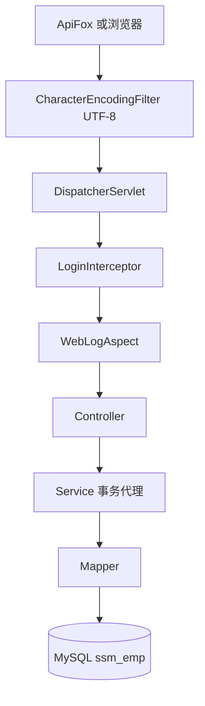
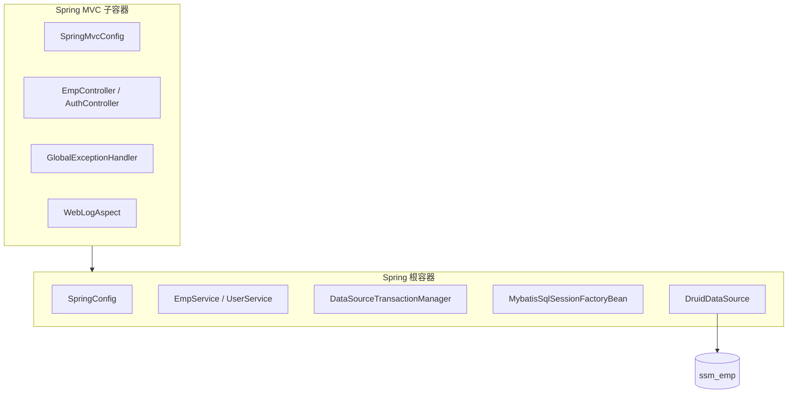

# 架构与接口清单

项目 `emp-mis`，打包 war，基础包 `com.lab.emp`。浏览器或 ApiFox 只和 DispatcherServlet 说话，业务写在 Service，SQL 由 MyBatis-Plus 发出。

## 请求怎么走

未登录时拦截器直接写 401 JSON，请求不会进入 Controller。`/login`、`/register`、OPTIONS 和静态页不拦截。

## 两个容器

根容器扫描 `com.lab.emp`，排除 Controller、ControllerAdvice、Aspect，以及 `SpringMvcConfig`。子容器只扫描 controller、common、aspect。全局异常和请求日志必须放在子容器里才会作用到接口。

## 数据

- `dept` 与 `emp` 一对多：一名员工的 `dept_id` 指向一个部门。
- `emp.dept` 仍保存部门名称。`GET /emps?dept=研发部` 按这个字段等值查询，不依赖关联查询。
- `sys_user` 只保存盐和 SHA-256 摘要。

`emp_name` 有普通索引 `idx_emp_name`。姓名条件是 `LIKE '%关键字%'`，前导百分号用不上这个索引的最左前缀，数据量上来后应改成更窄的条件或全文索引。列表 SQL 由分页插件加 `LIMIT`。

## 统一返回

| code | 含义 |
| --- | --- |
| 200 | 成功，`message` 为 `success` |
| 500 | 校验失败、业务失败，或未预期异常的对外文案 |
| 401 | 未登录 |

未预期异常的对外文案固定为「系统繁忙，请稍后重试」。堆栈只进 Log4j。

## 接口

默认分页 `page=1`、`size=5`。`page` 小于 1 时按第 1 页查。`size` 小于 1 时不返回数据行，只返回符合条件的总数。

| 方法 | 路径 | 作用 | 成功时 data |
| --- | --- | --- | --- |
| POST | `/login` | 登录，写入会话 `loginUser` | 用户名 |
| POST | `/register` | 注册 | null |
| POST | `/emps` | 新增员工，忽略传入的 empId | null |
| PUT | `/emps` | 按 empId 修改 | null |
| DELETE | `/emps/{id}` | 删除一名 | null |
| DELETE | `/emps` | 批量删除，体为 `List<Integer>` | null |
| GET | `/emps/{id}` | 查询一名 | Emp |
| GET | `/emps` | 分页多条件，参数 name、gender、dept、page、size | MyBatis-Plus `Page<Emp>` |

姓名 `like`，性别和部门 `eq`。排序为 `emp_id` 降序。

校验：`empName` 不能空白且最长 50，`salary` 不能空且不能为负。新增和修改使用 `@Valid`，并紧跟 `BindingResult`。

不存在的员工编号：查询、删除、修改返回 `code=500`，`message` 为「员工不存在」。空的批量删除数组返回「待删除的员工编号不能为空」。
